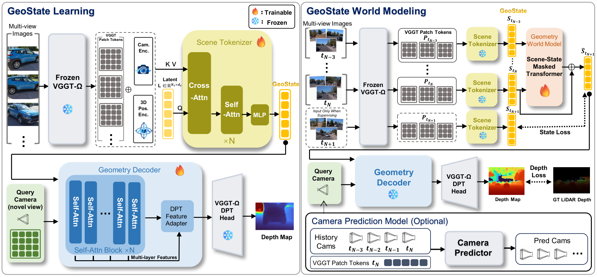

<div align="center">
<h1>
GeoState: Learning View-Decoupled Geometry<br>States for 3D World Modeling
</h1>

Hongchang Liu<sup>1</sup>, Jian Liu<sup>1</sup>, Yujuan Ding<sup>2</sup>, Liang Peng<sup>3</sup>,<br>
Xun Jiang<sup>1</sup>, Fei Ma<sup>4</sup>, Xing Xu<sup>1</sup>, Yi Bin<sup>1,†</sup>

<sup>1</sup>Tongji University &emsp; <sup>2</sup>Hong Kong Polytechnic University<br>
<sup>3</sup>Tencent &emsp; <sup>4</sup>Guangdong Laboratory of Artificial Intelligence and Digital Economy (SZ)

<a href="https://hongchang-liu.github.io/GeoState-project-page/"></a>
<a href=""></a>
<a href="https://huggingface.co/HongchangLiu/GeoState"></a>

[Setup](#setup) · [Inference](#inference) · [Evaluation](#evaluation) · [Training](#training) · [Citation](#citation)


<p align="center">
  
</p>

</div>

**TL;DR:** GeoState learns a compact, view-decoupled geometry representation from pretrained geometry foundation models, enabling 3D world modeling to predict scene dynamics independently of camera motion.

<a id="setup"></a>

## 🛠️ Setup

We train and test our model under the following environment:

- Ubuntu 22.04.5 LTS (x86_64)
- NVIDIA GeForce RTX 5090; driver 570.148.08
- CUDA 12.8 runtime
- Python 3.10.12
- PyTorch 2.11.0+cu128 and torchvision 0.26.0+cu128

1. Clone this repository.

```bash
git clone https://github.com/Hongchang-Liu/GeoState.git
cd GeoState
```

2. Create the environment and install packages.

```bash
conda create -n geostate python=3.10.12 -y
conda activate geostate
python -m pip install --upgrade pip==25.3
python -m pip install -r requirements.txt
python -m pip install -e . --no-deps --no-build-isolation
```

[`requirements.txt`](requirements.txt) pins all 45 dependencies, including the
CUDA runtime libraries, using PyPI and the official PyTorch CUDA 12.8 wheel
index. The optional
`environment.yml` installs the same requirements through conda.


3. Install the official VGGT-Ω source at the pinned commit.

```bash
git clone https://github.com/facebookresearch/vggt-omega.git third_party/VGGT-omega
git -C third_party/VGGT-omega checkout 39a0cb8af88554f15ddcb5354cd52bde588fa014
```

Our scene tokenizer imports this checkout directly. Its runtime dependencies are
covered by `requirements.txt`. Paths are configured in
[`configs/geostate.yaml`](configs/geostate.yaml). An existing official checkout
and weight file can be selected through `VGGT_OMEGA_IMPORT_ROOT_OVERRIDE` and
`VGGT_OMEGA_CHECKPOINT_OVERRIDE`.

4. Download the pretrained checkpoints from
[Hugging Face](https://huggingface.co/HongchangLiu/GeoState) into `checkpoints/`.

```bash
mkdir -p checkpoints
for file in geostate.pt world_model.pt camera_predictor.pt SHA256SUMS; do
  curl -fL "https://huggingface.co/HongchangLiu/GeoState/resolve/main/${file}" \
    -o "checkpoints/${file}"
done
```


| File | Model |
|---|---|
| [`geostate.pt`](https://huggingface.co/HongchangLiu/GeoState/blob/main/geostate.pt) | Scene tokenizer and geometry decoder |
| [`world_model.pt`](https://huggingface.co/HongchangLiu/GeoState/blob/main/world_model.pt) | Four-state residual world model |
| [`camera_predictor.pt`](https://huggingface.co/HongchangLiu/GeoState/blob/main/camera_predictor.pt) | Self-contained camera predictor, including its motion backbone |
| [`vggt_omega_1b_512.pt`](https://huggingface.co/facebook/VGGT-Omega/blob/main/vggt_omega_1b_512.pt) | Official frozen VGGT-Ω backbone and DPT head |

GeoState uses the frozen **VGGT-Ω 1B 512** backbone and DPT head. Download
`vggt_omega_1b_512.pt` separately from the
[official VGGT-Ω model repository](https://huggingface.co/facebook/VGGT-Omega)
and place it at `checkpoints/vggt_omega_1b_512.pt`.

<a id="inference"></a>

## 🚀 Inference

Run `scripts/infer.py` on the example provided in `examples/`. All arguments
are shown below:

```bash
python scripts/infer.py \
  --scene examples \
  --checkpoints checkpoints \
  --config configs/geostate.yaml \
  --camera-mode specified \
  --query-camera examples/query_camera.json \
  --query-intrinsics examples/query_intrinsics.json \
  --output outputs \
  --device cuda:0
```

The world model predicts ten future states at 0.2-second intervals, from
**t+0.2 to t+2.0**. Choose `--camera-mode specified` to decode all future states
at one fixed viewpoint, or `--camera-mode predicted` to decode each state at
its camera-predictor viewpoint. 

Inference settings:

- `--scene`: folder containing the four condition times (`t-0.6`, `t-0.4`,
  `t-0.2`, `t`), RGB images, calibrated intrinsics, and query-camera files.
- `--checkpoints`: directory containing `geostate.pt`, `world_model.pt`,
  `camera_predictor.pt`, and `vggt_omega_1b_512.pt`. 

- `--config`: GeoState architecture and official VGGT-Ω paths.
- `--camera-mode`: `specified` for a fixed user-specified camera; `predicted`
  for ten future cameras produced by the camera predictor.
- `--query-camera`: fixed camera-to-anchor JSON used in `specified` mode.
- `--query-intrinsics`: query camera intrinsics on the supplied image grid.
- `--output`: directory for numerical depth, preview images, and animation.
- `--device`: the device used for inference.


The example folder contains:

```text
examples/
├── images/                  # 12 images: four times × three cameras
├── condition.json           # Image paths, times, and camera order
├── intrinsics.json          # Input camera intrinsics
├── query_camera.json        # Query viewpoint
└── query_intrinsics.json    # Query camera intrinsics
```


### Outputs
Outputs include `depths.npz` (ten future float32 depth maps, timestamps, ten query
poses, K, and current depth/pose), `depth_t.png`, ten `depth_t_plus_*.png` previews,
`rollout.gif`, and `prediction.json`.

<a id="evaluation"></a>

## 📊 Evaluation

After [Setup](#setup), prepare the datasets below and run the evaluation commands
from the repository root with the released checkpoints. Use the provided JSON
manifests directly to evaluate the fixed samples. The scripts report GeoState
and Copy-Last under matched GT and
predicted query cameras.

<details>
<summary>Data layout and Waymo preprocessing</summary>

Arrange licensed datasets and prepared files under `data/`, or substitute your
own roots in the commands:

```text
data/
├── waymo/validation/             # Raw Waymo component parquet files
├── waymo_prepared/validation/    # Prepared segment tensors
├── waymo_sparse_cache/           # Fixed anchor and target LiDAR cache
├── kitti/                       # train/ and val/ with RGB, calibration, OXTS, timestamps
├── kitti_depth/                 # train/ and val/ with annotated image_02 depth
└── nuscenes/                    # samples/, sweeps/, and v1.0-trainval/ metadata
```

KITTI and nuScenes evaluation scripts perform preprocessing during evaluation.
For KITTI, use these paths under both
`train/` and `val/`:

```text
data/kitti/<split>/<date>/calib_cam_to_cam.txt
data/kitti/<split>/<date>/calib_velo_to_cam.txt
data/kitti/<split>/<date>/calib_imu_to_velo.txt
data/kitti/<split>/<date>/<drive>/image_02/data/<frame>.png
data/kitti/<split>/<date>/<drive>/image_02/timestamps.txt
data/kitti/<split>/<date>/<drive>/oxts/data/<frame>.txt
data/kitti_depth/<split>/<drive>/proj_depth/groundtruth/image_02/<frame>.png
```

For nuScenes, retain the official `samples/`, `sweeps/`, and `v1.0-trainval/`
directories; the manifest references files in both `samples/` and `sweeps/`.

<details>
<summary>Prepare Waymo validation data</summary>

Place the Waymo validation parquet files in the component directories
`camera_image/`, `camera_calibration/`, `vehicle_pose/`, `lidar/`, and
`lidar_calibration/` under `data/waymo/validation/`. Run the following once to
convert them into prepared segments and build the test100 sparse-depth cache.
Preparation uses balanced image resizing with corresponding transformed intrinsics.
With matching prepared files and caches ready, proceed to the Waymo evaluation command.

```bash
geostate-prepare-waymo \
  --waymo-root data/waymo --output-root data/waymo_prepared \
  --split validation

python scripts/prepare_waymo_eval_cache.py \
  --selection manifests/waymo_test100.json \
  --prepared-root data/waymo_prepared/validation \
  --output-root data/waymo_sparse_cache
```

The preparation command supports `--shard-index` and `--shard-count`.
The evaluation cache fixes the tenth logical 5-Hz anchor and future targets
within 20 ms. Scene encoding uses observed history RGB; future LiDAR supplies
the scoring targets.

</details>

</details>

### Waymo

```bash
python scripts/eval_waymo.py \
  --selection manifests/waymo_test100.json \
  --sparse-cache-root data/waymo_sparse_cache \
  --prepared-root data/waymo_prepared/validation \
  --raw-root data/waymo/validation \
  --config configs/geostate.yaml \
  --scene-checkpoint checkpoints/geostate.pt \
  --world-checkpoint checkpoints/world_model.pt \
  --camera-checkpoint checkpoints/camera_predictor.pt \
  --output outputs/waymo_test100.json
```

### KITTI 

Keep the full 151-sequence Depth Completion train/val RGB population under
`data/kitti/`: the script checks this population, then evaluates the 113 sequences
in the provided manifest. Include their history RGB/OXTS and future depth labels.

```bash
python scripts/eval_kitti.py \
  --kitti-root data/kitti --depth-annotated-root data/kitti_depth \
  --manifest manifests/kitti_test113.json \
  --config configs/geostate.yaml \
  --scene-checkpoint checkpoints/geostate.pt \
  --world-checkpoint checkpoints/world_model.pt \
  --camera-checkpoint checkpoints/camera_predictor.pt \
  --output outputs/kitti_test113.json
```

### nuScenes 

```bash
python scripts/eval_nuscenes.py \
  --dataroot data/nuscenes --manifest manifests/nuscenes_test150.json \
  --config configs/geostate.yaml \
  --scene-checkpoint checkpoints/geostate.pt \
  --world-checkpoint checkpoints/world_model.pt \
  --camera-checkpoint checkpoints/camera_predictor.pt \
  --output outputs/nuscenes_test150.json
```

<details>
<summary>Metrics and evaluation manifests</summary>

Results are saved to the JSON file specified by `--output`. Depth metrics are
`abs_rel` (lower is better) and `delta1` (higher is better), reported per horizon
and as `overall` frame averages.
Waymo and KITTI evaluate t+0.2, 0.4, …, 2.0 s; nuScenes evaluates t+0.75, 1.25,
and 2.5 s.

**Manifests**

| File in `manifests/` | Purpose |
|---|---|
| `waymo_test100.json` | 100 official validation segments, seed `20260804` |
| `kitti_test113.json` | 113 eligible Depth Completion train/val sequences with fixed frames |
| `nuscenes_test150.json` | All 150 official validation scenes with fixed camera/LiDAR records |

View optional arguments with `--help`, using the corresponding evaluation script:

```bash
python scripts/eval_waymo.py --help
```

</details>

<a id="training"></a>

## 🚗 Training

Training proceeds through GeoState pretraining, static-Waymo adaptation,
one-step world-model initialization, and autoregressive rollout training.

### 0. Data preparation

Prepare the five-dataset tokenizer caches, Waymo segment tensors, and temporal
motion pools before training. Use `manifests/geostate_pretrain.json` for
pretraining scenes, the static temporal pool for GeoState adaptation, and the
all-temporal pool for world-model training.

| File in `manifests/` | Purpose |
|---|---|
| `geostate_pretrain.json` | 9,496 multi-dataset pretraining scenes |
| `waymo_val102_all_temporal.jsonl` | 17,840 candidate selection windows across 102 segments |
| `waymo_val102_static_temporal.jsonl` | 3,094 static selection windows across 37 of those segments |

The JSONL files store one selection window per line. Checkpoint selection uses
a separate 102-segment pool, disjoint from Waymo test100.

<details>
<summary>Dataset preparation and teacher caches</summary>

**Multi-dataset pretraining**

The pretraining manifest lists scenes from DL3DV, CO3D, RealEstate10K, TartanAir,
and WildRGBD. Place DL3DV's NeRF-format scenes at the manifest paths under
`data/dl3dv/`. Prepare CO3D annotations and images under `data/raw/co3d/`,
RealEstate10K `.torch` train shards under `data/raw/re10k/train/`, and paired
TartanAir `image_left.zip` / `depth_left.zip` archives under `data/tartanair/`.
The converters use the released scene selection; the WildRGB-D preparation script downloads RGB images, camera intrinsics, and poses for the scenes listed in the manifest.

```bash
geostate-prepare-pretrain \
  --dataset co3d --raw-root data/raw/co3d \
  --manifest manifests/geostate_pretrain.json --data-root data
geostate-prepare-pretrain \
  --dataset re10k --raw-root data/raw/re10k/train \
  --manifest manifests/geostate_pretrain.json --data-root data
geostate-prepare-wildrgbd \
  --manifest manifests/geostate_pretrain.json --output-root data/wildrgbd_prepared
geostate-prepare-tartanair \
  --archive-root data/tartanair --output-root data/tartanair_prepared
```

TartanAir preparation extracts pixel-aligned GT z-depth and records its paths in
`transforms.json` for `--use-tartanair-gt-depth`. Build teacher caches next:

```bash
geostate-train-stage1-ddp cache-shard \
  --config configs/geostate.yaml \
  --candidate-manifest manifests/geostate_pretrain.json \
  --rank 0 --world-size 4 --device cuda:0 \
  --output outputs/teacher_cache/shard0.json
```

For four cache shards, repeat the cache command with ranks 0–3 and a corresponding
GPU and output filename for each rank. Caches are stored at `data/cache/teacher`,
configured by `data.cache_root` in `configs/geostate.yaml`. Provide a local
`--validation-manifest` for pretraining checkpoint selection.

**Waymo training pools**

Prepare both splits, then generate temporal windows from the prepared segments
and raw 3D track annotations:

```bash
geostate-prepare-waymo \
  --waymo-root data/waymo --output-root data/waymo_prepared \
  --split train
geostate-prepare-waymo \
  --waymo-root data/waymo --output-root data/waymo_prepared \
  --split validation

python -m vggt_scene_tokenizer.data.waymo_pools \
  --waymo-root data/waymo --prepared-root data/waymo_prepared \
  --output-root manifests/waymo_pools
```

For each split, this generates `*_static_temporal.jsonl`, `*_dynamic_temporal.jsonl`,
and their union `*_all_temporal.jsonl`. Pool assignment uses the paper's
class-specific motion and LiDAR-support thresholds. Tokenizer adaptation reads
`train_static_temporal.jsonl`; world-model training reads `train_all_temporal.jsonl`.
Checkpoint selection uses the released `waymo_val102_*.jsonl` files.

**World-model motion masks**

Generate masks from the annotated 3D boxes in the Waymo `lidar_box/` components:

```bash
geostate-prepare-waymo-masks \
  --waymo-root data/waymo --output-root data/waymo_motion_masks \
  --splits train validation
```

The FRONT masks are stored at
`data/waymo_motion_masks/{train,validation}/<segment>/FRONT/<timestamp>.png`,
on the prepared depth grid. They mark objects moving faster than 0.5 m/s for
one-step validation's pixel-region statistics. Temporal pool assignment uses
the class-specific window rules described above.

</details>

### 1. GeoState Representation Learning

Pretrain on 9,496 scenes for 200k updates, then adapt to static Waymo windows
for 50k updates. VGGT-Ω remains frozen throughout both stages.

<details>
<summary>Pretraining and Waymo adaptation commands</summary>

Both commands use four processes, with one sample per process and nine gradient
accumulation steps, for an effective batch size of 36.

**Multi-dataset pretraining**

```bash
torchrun --standalone --nproc-per-node=4 \
  -m vggt_scene_tokenizer.training.large_scale train-ddp \
  --config configs/geostate.yaml \
  --scene-manifest manifests/geostate_pretrain.json \
  --steps 200000 --lr 1e-5 --grad-accumulation 9 \
  --min-input-views 1 --max-input-views 5 \
  --anchor-view-dropout 0.4 --random-view-dropout 0.4 \
  --use-tartanair-gt-depth \
  --output-dir outputs/geostate_pretrain
```

**Static-Waymo adaptation**

```bash
torchrun --standalone --nproc-per-node=4 \
  -m vggt_scene_tokenizer.training.large_scale train-ddp \
  --config configs/geostate.yaml \
  --waymo-prepared-root data/waymo_prepared/train \
  --waymo-static-temporal-manifest manifests/waymo_pools/train_static_temporal.jsonl \
  --waymo-validation-prepared-root data/waymo_prepared/validation \
  --waymo-validation-static-temporal-manifest manifests/waymo_val102_static_temporal.jsonl \
  --init-from outputs/geostate_pretrain/final.pt \
  --steps 50000 --lr 5e-6 --warmup-steps 2000 --grad-accumulation 9 \
  --min-input-views 3 --max-input-views 5 \
  --output-dir outputs/geostate_waymo
```

The example initializes from `final.pt`; substitute your selected pretraining
checkpoint if you used a separate validation manifest. `--init-from` loads the
tokenizer and geometry decoder with a fresh optimizer and step counter.
Tokenizer training's `--resume` continues an interrupted run. Waymo adaptation
uses three synchronized source cameras plus one or two temporal images for
four- or five-view draws; the three source-camera blocks enter tokenizer memory.
Tokenizer adaptation selects `best_validation.pt` using the released
`waymo_val102_static_temporal.jsonl`, scoring ten future FRONT horizons at fixed
anchors. Prepare all segments referenced by this file.

</details>

### 2. World model

Train the one-step model for 20k updates, then initialize seven-step
autoregressive rollout training for 35k new updates. GeoState and VGGT-Ω remain
frozen during these stages. Rollout training encodes the twelve context images
once and supervises seven future FRONT depth maps.

<details>
<summary>One-step and autoregressive rollout commands</summary>

**One-step initialization**

The objective is `SmoothL1_0.1 + 0.05 cosine + 0.24 log-depth`.

```bash
torchrun --standalone --nproc-per-node=4 \
  -m vggt_scene_tokenizer.training.waymo_online_one_step \
  --config configs/geostate.yaml \
  --scene-checkpoint checkpoints/geostate.pt \
  --train-prepared-root data/waymo_prepared/train \
  --train-manifest manifests/waymo_pools/train_all_temporal.jsonl \
  --train-motion-mask-root data/waymo_motion_masks/train \
  --validation-prepared-root data/waymo_prepared/validation \
  --validation-sequences 102 \
  --validation-manifest manifests/waymo_val102_all_temporal.jsonl \
  --validation-motion-mask-root data/waymo_motion_masks/validation \
  --output-dir outputs/world_onestep
```

**Autoregressive rollout**

Train seven-step autoregressive predictions with the depth objective.

```bash
torchrun --standalone --nproc-per-node=4 \
  -m vggt_scene_tokenizer.training.waymo_online_rollout \
  --config configs/geostate.yaml \
  --scene-checkpoint checkpoints/geostate.pt \
  --resume outputs/world_onestep/best_onestep.pt \
  --train-prepared-root data/waymo_prepared/train \
  --train-manifest manifests/waymo_pools/train_all_temporal.jsonl \
  --train-motion-mask-root data/waymo_motion_masks/train \
  --validation-prepared-root data/waymo_prepared/validation \
  --validation-sequences 102 \
  --validation-manifest manifests/waymo_val102_all_temporal.jsonl \
  --validation-motion-mask-root data/waymo_motion_masks/validation \
  --output-dir outputs/world_rollout
```

The rollout trainer's `--resume` initializes weights from the one-step stage
with a fresh optimizer and schedule. Both stages use
`waymo_val102_all_temporal.jsonl` for checkpoint selection, separate from Waymo
test100. One-step selection saves `best_onestep.pt`; rollout selection saves
`best_rollout.pt`.

</details>

### 3. Export checkpoints

<details>
<summary>Export inference weights</summary>

Export the selected checkpoints to fresh output paths:

```bash
python scripts/export_inference_checkpoint.py --kind geostate \
  --input outputs/geostate_waymo/best_validation.pt \
  --output exports/geostate.pt
python scripts/export_inference_checkpoint.py --kind world \
  --input outputs/world_rollout/best_rollout.pt \
  --output exports/world_model.pt
python scripts/export_inference_checkpoint.py --kind camera \
  --input /path/to/camera_training.pt --pose-checkpoint /path/to/pose_training.pt \
  --output exports/camera_predictor.pt
```

GeoState exports contain tokenizer and decoder weights; the frozen VGGT-Ω weights
load separately. World-model exports contain the predictor weights and configuration.

</details>

<a id="citation"></a>

## 🎓 Citation

If you use GeoState in your research, please cite:

```bibtex
@misc{liu2026geostate,
  title  = {GeoState: Learning View-Decoupled Geometry States for 3D World Modeling},
  author = {Hongchang Liu and Jian Liu and Yujuan Ding and Liang Peng and
            Xun Jiang and Fei Ma and Xing Xu and Yi Bin},
  year   = {2026}
}
```

GeoState builds on [VGGT-Ω](https://github.com/facebookresearch/vggt-omega).
We thank its authors and the dataset providers for making their work available.
GeoState source code is released under the [MIT License](LICENSE).
VGGT-Ω, its weights, and datasets retain their own terms; see
[third-party notices](THIRD_PARTY_NOTICES.md).
